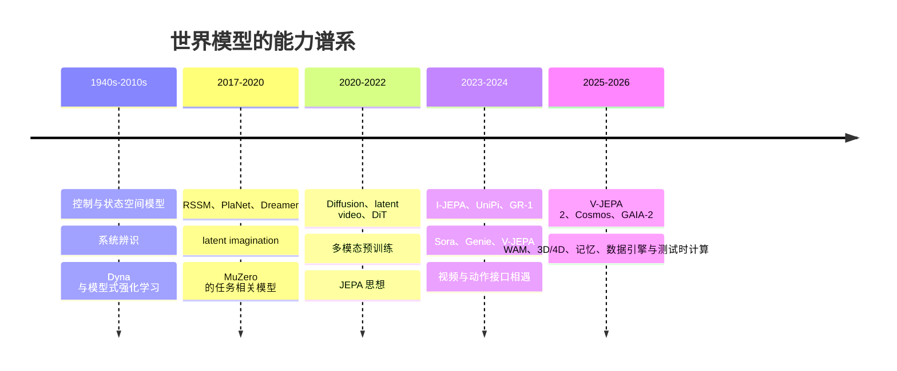

# 世界模型历史沿革：能力、方法与研究群体如何汇合

世界模型不是某一篇论文或某一类视频模型突然发明的名词。它的历史是多个研究传统围绕同一问题逐步汇合：**如何从部分观测中形成状态，预测行动后果，并在真正执行前进行推演。**

## 0. 总览：五条来源、一次工程汇合

## 1. 前史：控制和认知中的“内部模型”（1940s—2017）

世界模型最初不是视频生成概念，而是控制、认知和强化学习中的内部模型：智能体看不到完整状态，只能根据传感器、过去动作和先验估计状态，再预测行动后果。

- **状态空间与系统辨识**：以 `x_{t+1}=f(x_t,u_t)` 描述可控系统；今天的 latent dynamics 仍在解决同一问题，只是 `x` 从手工状态换成了神经表示。
- **Dyna（1991）**：把真实经验学习与模型内生成的想象经验交替，用模型服务规划而非只服务重建。
- **模型式 RL**：强调模型错误会被策略利用，因此模型价值不取决于图像好看，而取决于是否足够支持决策。

这一时期留下的标准仍然有效：状态估计、动作条件转移、奖励/价值、规划、模型偏差和不确定性。

## 2. 潜状态世界模型成熟（2018—2020）

Ha 与 Schmidhuber 的 World Models 将 VAE、RNN 与控制器组合，展示可在压缩视觉世界中训练策略。PlaNet、Dreamer 系列用 RSSM 将后验状态、先验 dynamics 和想象 rollout 变为标准组件；MuZero 进一步说明世界模型不必重建所有观测，只要预测对规划真正重要的 reward、value 与 policy 即可。

| 贡献 | 今天可复用的基础 |
|---|---|
| latent state | 从像素压缩为可 rollout 的状态 |
| posterior/prior | 处理部分可观测和不确定未来 |
| imagination | 用模型内轨迹训练 value / actor |
| planning-aware target | 预测任务充分信息而非所有细节 |

## 3. 视频生成与多模态底座成熟（2020—2022）

扩散模型、latent diffusion、时空 Transformer 和 DiT 解决了大规模视觉生成的可扩展性；CLIP、VLM 和语言模型让文本成为通用任务条件；NeRF、3DGS 和动态重建为“从像素回到空间”提供了表达工具。

这一步解释了当下热潮：研究员已经拥有视频 tokenizer、扩散/flow 训练配方、Transformer 扩展规律、多模态条件接口和庞大预训练权重。世界模型不必从零开始训练。

## 4. JEPA 提出另一条预测观（2022—2024）

JEPA 的关键判断是：世界并非所有像素都可预测，也非所有像素都值得预测；预测应发生在抽象表示空间。I-JEPA 先在图像中验证遮蔽表征预测，V-JEPA 将它扩展到视频。其工程价值是降低高频像素重建压力，保留对运动、对象和任务更有用的特征。

这也形成至今最重要的路线分歧：

- 像素/视频路线希望同时提供人类可见的未来和世界先验；
- JEPA/latent 路线优先获得可规划、低时延、任务相关的状态；
- 二者可共享 encoder、tokenizer、数据和动作对齐，而不是二选一。

## 5. 2023—2024：视频、动作和机器人开始有共同接口

| 节点 | 意义 |
|---|---|
| I-JEPA / V-JEPA | 预测 embedding 成为可扩展自监督路线 |
| UniPi、GR-1 | 未来视觉和动作进入机器人策略训练 |
| Sora | 把大规模视频生成与“世界模拟器”叙事绑定，但也暴露物理评测缺口 |
| Genie | 从无标签视频发现 latent action，开始生成可交互环境 |
| LAPA、VPP 等 | 试图把无动作视频的知识对齐到可执行动作 |

这时“视频生成是世界模型”成为产业叙事，但严谨研究开始追问：动作是否真的被模型使用？多视角/重访是否保持？是否能提高机器人规划？

## 6. 2025—2026：问题从模型数量转向系统分解

这一阶段的特征不是单纯更大的模型，而是研发链条逐渐可模块化：

- **动作条件后训练**：V-JEPA 2 采用无动作视觉预训练，再使用少量机器人数据建立动作条件规划接口。
- **世界—动作联合建模**：WAM 将未来视觉/状态监督与动作生成放在一套模型中，解决“视频 Base 与机器人 action space 不匹配”。
- **3D/4D 与对象状态**：从附加深度 head 走向共享空间表示、结构化记忆和多视角一致性。
- **长序列问题**：从“加长 context”转为“如何写入、检索、校正和撤销事实”。
- **数据引擎**：Cosmos、GAIA、World Labs 等把模型、数据筛选、仿真、合成和评测打包为 Physical AI 工作流。
- **测试时计算**：生成多个未来、用 value/verifier 评分，再选择动作；推理流程本身成为研究变量。

## 7. 研究群体为什么能够迁移进来

| 群体 | 带来的能力 | 进入 WM 后最常见盲点 |
|---|---|---|
| 视频生成 | tokenizer、diffusion、长视频、视觉质量 | 把视觉合理性当物理真实 |
| 多模态 / NLP | 语言条件、token 接口、预训练与后训练 | 忽视坐标、时延和接触语义 |
| JEPA / 自监督 | 预测表征、masking、样本效率 | 潜状态可能不保留可控几何 |
| 3D/图形学 | 多视角、渲染、显式空间与资产 | 表示完整不等于有动力学 |
| 机器人 / 控制 | 动作、规划、闭环和安全 | 小数据难以支撑开放视觉世界 |
| 系统 / 数据工程 | 大规模清洗、部署、吞吐、监控 | 容易将效率指标替代能力指标 |

## 8. 历史留下的三条判断

1. 世界模型的核心问题一直是状态、转移和规划；视频生成只是现代可扩展底座之一。
2. 每次“能力跃迁”都来自新的接口：latent state、video token、language condition、action alignment、3D memory，而不是单个论文命名。
3. 未来竞争将取决于谁能把生成、结构、因果、记忆、评测与部署连成真实闭环。

## 参考阅读

- [World Models](https://worldmodels.github.io/)
- [MuZero](https://deepmind.google/blog/muzero-mastering-go-chess-shogi-and-atari-without-rules/)
- [DreamerV3](https://arxiv.org/abs/2301.04104)
- [V-JEPA](https://ai.meta.com/blog/v-jepa-yann-lecun-ai-model-video-joint-embedding-predictive-architecture/)
- [Genie](https://arxiv.org/abs/2402.15391)
- [World 模型工程主线](领域的理解.md)
