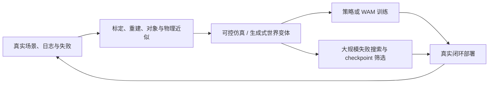

# 模拟器、3D 重建与数据引擎

## 1. 三类系统的职责

| 系统 | 主要产物 | 适合做什么 | 不能替代什么 |
|---|---|---|---|
| 物理引擎 | 可计算状态与接触 | 反事实、控制、真值标签 | 真实外观和复杂材料 |
| 3D 重建 / 3DGS | 高保真外观与几何 | 重放、视角增强、空间记忆 | 新交互动力学 |
| 生成式 WM | 可控未来与场景变体 | 合成数据、world prior、交互渲染 | 自动的物理正确性 |

实际数据引擎通常是混合系统，而不是一个“神经模拟器”替代全部传统组件。

## 2. Real-to-Sim-to-Real 闭环

关键验收不是仿真画面是否像真实，而是它能否保持**策略排序、失败区域和改动方向**与真实系统一致。

## 3. 数据引擎 Pipeline

1. 采集真实传感器、动作、任务和失败轨迹；
2. 标定并重建相机、物体、场景和可用 collision proxy；
3. 用物理引擎、3D资产或生成模型扩展视角、布局、光照、摩擦、物体和事件；
4. 生成可追踪的训练 shard 与精确状态/接触标签；
5. 在仿真中训练、对抗搜索和筛选；
6. 用真实 closed-loop 校准数据分布、成功边界和风险。

## 4. 最小工程方案

对于台面操作：RGB-D + robot calibration → 物体级 mesh/collider → 小规模真实交互校准 → 物理引擎变体 → 真实 holdout 验证。若加入 3DGS，优先用在背景/外观与新视角，而非直接把 splat 当碰撞几何。

对于自动驾驶：多传感器日志 → 地图/轨迹/agent 状态 → 程序化或生成式天气与交通变体 → 感知/策略/安全评测 → 真实 log replay 与 on-road 验证。

## 5. 评测

- observation alignment：图像、深度、位姿与对象运动；
- dynamics alignment：接触、轨迹、成功/失败边界；
- policy ranking：仿真是否保留模型、数据和 checkpoint 的相对排序；
- coverage：场景、对象、失败模式、embodiment 与物理参数覆盖；
- economics：一次重建可复用给多少任务、策略和硬件。

## 6. 风险

- 生成式数据的错误被模型学习并在评测中再次被奖励；
- 高外观保真掩盖尺度、碰撞和摩擦错误；
- 只在成功中心区域校准，边界和失败区域偏差最大；
- 使用封闭仿真训练和同源仿真评测，无法证明真实迁移。

## 参考

- [NVIDIA Cosmos](https://www.nvidia.com/en-us/ai/cosmos/)
- [Wayve Ghost Gym](https://wayve.ai/thinking/ghost-gym-neural-simulator/)
- [World Labs R2S2R](https://www.worldlabs.ai/blog/real-to-sim-to-real)
