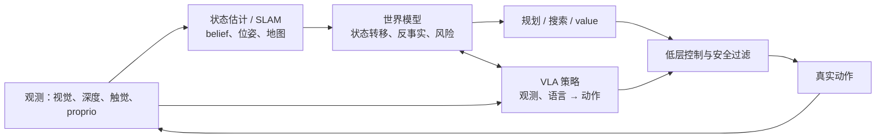

# WM、WAM、VLA 与 SLAM：系统功能分解

## 1. 先按功能，而非按营销名称分解

一个端到端模型可在参数上合并这些模块，但在评测和故障分析时仍应按功能分开。

## 2. 形式关系

| 模块 | 典型函数 | 主要输出 |
|---|---|---|
| SLAM / belief | `p(x_t,m | o≤t,a<t)` | 当前位姿、地图、置信度 |
| WM | `p(z_{t+1}|z_t,a_t,c)` | 未来状态/观测、风险、价值线索 |
| VLA | `π(a_t|o≤t,c)` | 可执行动作或 action chunk |
| WAM | `p(z_{t+1},a_t|z≤t,c)` | 联合 future 与 action |
| Planner | `argmax_a E[return]` | 候选动作选择 |

## 3. SLAM 会不会被 WM 替代？

不会整体替代。SLAM 主要解决当前状态估计、几何融合、回环和漂移校正；典型 WM 主要解决未来状态转移和反事实 rollout。动态语义 SLAM 具有对象、速度甚至短期轨迹预测后，会成为结构化 WM 的优秀前端；但若没有动作条件未来和决策接口，仍主要属于状态估计。

## 4. VLA 是否天然包含 WM？

不天然。标准 VLA 只需把视觉和语言映射到动作；它可能隐式学到世界规律，但除非显式预测未来、使用 rollout 或被动作干预实验证明，否则不能把“策略成功”直接解释为“已有可调用世界模型”。

## 5. 四种系统组织方式

| 方式 | 适用情况 | 风险 |
|---|---|---|
| 纯 VLA | 高频、短时、数据覆盖充分 | 难解释长时失败和反事实 |
| VLA + 预测辅助 | 想提升表示与样本效率 | 预测分支可能只是正则 |
| WM + Planner + 小控制器 | 高风险、需 lookahead | 模型误差与计算成本 |
| 联合 WAM | 想共享视觉、动作和未来监督 | action schema、数据混合和评测复杂 |

## 6. 系统验收问题

- 哪个模块在何时被调用？
- 哪个模块的输出会真正改变动作？
- 状态、动作和地图处于哪个坐标系，谁负责校准？
- 预测错误、定位丢失、超时和不确定性如何处理？
- 是否存在纯 VLA、无 WM、无 SLAM 或 oracle state 对照？

## 参考

- [RT-2](https://deepmind.google/blog/rt-2-new-model-translates-vision-and-language-into-action/)
- [OpenVLA](https://arxiv.org/abs/2406.09246)
- [DynaGSLAM](https://arxiv.org/abs/2503.11979)
- [VLA 文档中的接口章节](../../vla/领域的理解.md)
