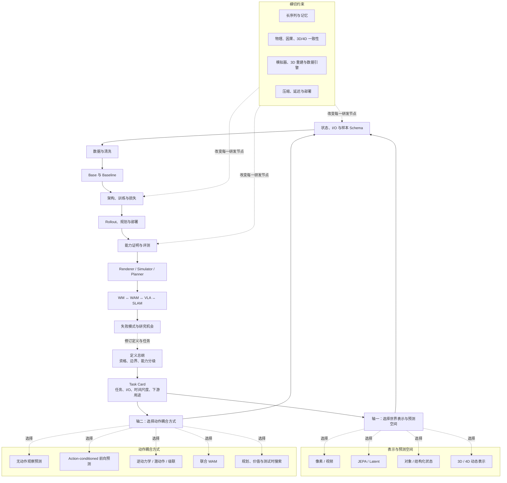

# 世界模型：定义总纲与工程主线

> 本文是世界模型工程手册的主入口。目标是在 15—20 分钟内回答：什么有资格叫世界模型、如何把它做成可验证的模型、不同路线到底差在哪里、它与 VLA / WAM / SLAM 怎样协作。

## 0. 一句话结论

世界模型不是“能够生成未来视频”的同义词，而是一个**以内部世界状态为中心、预测状态在条件和动作作用下如何变化、并能服务模拟或决策的模型**。

未来预测是最小训练接口；物理、空间、因果理解是需要实验支撑的能力主张；闭环规划或真实任务收益是最强用途证据。

给定观测历史 `o≤t`、动作历史 `a<t`、任务或语言条件 `c`，一个通用的因子化为：

\[
z_t \sim q_\phi(z_t\mid o_{\le t}, a_{<t}, c),\qquad
z_{t+1} \sim p_\theta(z_{t+1}\mid z_t,a_t,c)
\]

\[
\hat o_t\sim p_\psi(o_t\mid z_t),\qquad
(\hat r_t,\hat d_t,\hat v_t) = h_\omega(z_t,a_t,c)
\]

`z` 可以是视频 token、JEPA embedding、对象状态、BEV/occupancy、3D Gaussian、4D 场或混合记忆；策略 `π(a|z,c)` 与世界模型相关，但不是同一个定义对象。

## 1. 四个必须分开的层次

| 层次 | 要回答的问题 | 典型错误 |
|---|---|---|
| 定义 | 什么资格叫 WM？ | 把所有视频生成、VLM 或 VLA 都叫 WM |
| 任务 | 预测什么、由谁条件化？ | 把视频、3D、动作当成互斥路线 |
| 工程 | 数据、Base、损失、推理怎样闭环？ | 只报模型结构，不报样本与评测 |
| 证据 | 如何证明能力可用于决策？ | 用 FVD 或 demo 代替物理与闭环证据 |

### 1.1 工作定义与能力分级

- **L0 渲染器**：从文本、图像或条件产生视觉上合理的观测；可以是强生成模型，但不保证状态或物理正确。
- **L1 观察预测器**：从历史预测未来观测或特征；证明时序相关性，不必证明动作因果。
- **L2 状态模拟器**：维护能跨视角、遮挡和时间使用的状态，并预测其演化。
- **L3 动作条件模拟器**：同一状态下，能区分不同动作引起的不同未来，并在失败动作上保持校准。
- **L4 决策世界模型**：模型内 rollout 能提升候选动作排序、规划或价值估计。
- **L5 可部署世界模型**：在目标场景的时延、风险和分布偏移下，闭环收益能稳定迁移到真实系统。

一项工作应声明自己达到哪个层级；没有 L3 证据时，最好称为“预测表征”或“生成式环境模型”，而非强因果世界模型。

### 1.2 与相邻概念的边界

| 概念 | 核心函数 | 与 WM 的关系 |
|---|---|---|
| 时间序列预测 | `p(y未来|y历史)` | 受控状态空间模型可成为 WM；普通被动预测通常不是 |
| 视频生成 | 生成视觉轨迹 | 可作为像素 WM 的 Base 或 decoder，不自动代表物理模拟 |
| 3D 资产生成 | 构建静态空间 | 是空间表示/数据资产；加入动态与动作后才更接近 WM |
| SLAM | 当前位姿与地图估计 | 是状态估计和空间记忆，可做 WM 前端 |
| VLA | 观测、语言到动作 | 是策略；隐藏层可能有预测知识，但不天然包含 WM |
| WAM | 未来世界与动作联合建模 | WM 与 VLA 的交汇形式 |

详见：[定义、边界与能力分级](基础/定义、边界与能力分级.md)、[WM、WAM、VLA 与 SLAM](系统与研究/WM、WAM、VLA与SLAM.md)。

## 2. 领域认知图：双轴、流程与横切问题

这张图刻意不把“视频生成、JEPA、3D、WAM”放成四条互斥路线：前四项首先回答世界用什么表示，WAM 首先回答动作怎样进入。真实系统通常位于两个轴的一个组合点，例如“潜空间 + 动作条件 + MPC”或“3D 状态 + 联合 WAM”。

## 3. 主线：从研究问题走到可信系统

### Step 1：先写 Task Card，而不是先选模型

每个项目第一页必须固定：目标用户、环境范围、观测、动作语义、状态表示、预测跨度、是否需要多模态未来、谁消费输出、接受什么风险。最小卡片与 JSON 样本见 [任务定义与输入输出协议](基础/任务定义与输入输出协议.md)。

### Step 2：用数据和坐标系定义问题的上限

无动作互联网视频提供视觉与常识先验；机器人和自动驾驶轨迹提供可干预动作；模拟器提供状态、接触和反事实；3DGS/NeRF 提供外观和几何重建，但不会自动提供动力学。数据应完成时间同步、外参与动作坐标统一、质量过滤、场景级切分和版本记录。见 [数据获取清洗与样本规范](基础/数据获取清洗与样本规范.md)。

### Step 3：区分 Base 与 Baseline

Base 是可迁移初始化，如视频扩散模型、VLM、JEPA encoder、RSSM 或 3D encoder；Baseline 是在同一任务、数据、预算与评测协议下能复现的完整系统。一个“收敛 Base”只证明可训练，不保证物理因果或真实闭环。见 [Base、Backbone 与 Baseline](基础/Base、Backbone与Baseline.md)。

### Step 4：明确联合目标实际在优化什么

常见总损失写作：

\[
\mathcal L = \lambda_{obs}\mathcal L_{obs}+\lambda_{dyn}\mathcal L_{dyn}+\lambda_{act}\mathcal L_{act}+\lambda_{geo}\mathcal L_{geo}+\lambda_{val}\mathcal L_{val}+\lambda_{mem}\mathcal L_{mem}
\]

权重、有效 mask、horizon 和 teacher-forcing 比例共同决定“模型到底学什么”。只有动作损失不等于学到动作后果；只有像素重建不等于学到任务相关状态。见 [训练 Pipeline 与损失函数](基础/训练Pipeline与损失函数.md)。

### Step 5：把推理成本也写成系统设计

训练时生成视频、推理时关闭 decoder 的“train-rich / infer-light”策略很常见；但必须通过消融证明收益来自世界建模而非更强 Base。推理路径需说明是直接策略、MPC、beam search、value rerank 还是安全 verifier。见 [规划、价值模型与测试时搜索](动作与决策/规划、价值模型与测试时搜索.md)。

### Step 6：用证据阶梯而不是单一生成指标验收

| 证据层 | 最小问题 | 推荐实验 |
|---|---|---|
| 预测 | 是否预测了真实未来？ | 分 horizon 的 NLL / feature error |
| 结构 | 对象、空间、身份是否保持？ | 重访、遮挡、多视角和几何一致性 |
| 因果 | 是否理解动作影响？ | 动作打乱、配对干预、失败动作 |
| 规划 | 模型内选择是否更好？ | rollout 排序、regret、MPC 消融 |
| 闭环 | 是否迁移到真实任务？ | 成功率、安全率、sim-real 排名相关性 |

FVD、PSNR、LPIPS 只能做视觉质量证据，不能单独作为物理或动作忠实度证据。完整协议见 [能力证明、指标与实验协议](基础/能力证明、指标与实验协议.md)。

## 4. 当前技术路线怎样读

| 组合 | 适合的问题 | 最小 Baseline | 首要风险 |
|---|---|---|---|
| 视频 + 无动作 | 预测表征、视频预训练 | video tokenizer + AR/diffusion | 视觉逼真代替可控性 |
| 视频 + 动作条件 | 交互世界、驾驶、机器人视频预测 | V2W / diffusion + action encoder | 动作被忽略、rollout 漂移 |
| JEPA/latent + 动作 | 快速规划、低时延 | encoder + latent predictor + CEM | 潜变量失去几何和接触细节 |
| 对象/状态 + 动作 | 可解释任务与因果 | state-space model + object tracker | 感知误差传递、对象集合不稳定 |
| 3D/4D + 动作 | 多视角、空间记忆、数字孪生 | occupancy/GS + dynamics head | 几何、物理和效率难以同时满足 |
| 联合 WAM | 统一动作与未来监督 | video/world Base + action head | action schema 与真实控制接口失配 |

各路线的工程细节位于 [表示与预测空间](表示与预测空间/index.md) 与 [动作与决策](动作与决策/index.md)。

## 5. 当前能做什么，不能做什么

当前成熟的价值多在“离线世界”：合成数据、场景变体、策略预训练、仿真评测和内容/空间生成。交互式视频世界、动作条件驾驶模拟和少样本机器人潜空间规划已经出现可用原型，但通用、高频、长时、接触丰富的真实机器人世界模型仍未成熟。

- **可以相对可靠地做**：已见分布下的短至中期预测、条件场景变体、受限动作空间交互、仿真数据增强、模型 checkpoint 筛选。
- **仍需慎称的能力**：精确物理、小时级记忆、多智能体因果、软体/液体接触、跨机器人动作泛化、安全认证。
- **商业落点**：把真实场景转为可复用的训练/评测世界；通过大量受控变体发现失败，再用真实闭环回灌数据。

详见 [模拟器、3D 重建与数据引擎](横切专题/模拟器、3D重建与数据引擎.md)、[失败模式与研究机会](系统与研究/失败模式与研究机会.md)。

## 6. 推荐阅读路径

- **先形成概念判断**：本文 → [定义、边界与能力分级](基础/定义、边界与能力分级.md) → [WM、WAM、VLA 与 SLAM](系统与研究/WM、WAM、VLA与SLAM.md)。
- **准备做第一个模型**：任务/I-O → 数据 → Base/Baseline → 训练/损失 → 评测。
- **做机器人或具身系统**：动作条件与逆动力学 → WAM → 规划/搜索 → 长序列/记忆 → VLA 接口。
- **做空间/仿真系统**：对象状态 → 3D/4D → 物理一致性 → 数据引擎 → 部署。

## 参考入口

- [World Models（Ha & Schmidhuber, 2018）](https://worldmodels.github.io/)
- [MuZero](https://deepmind.google/blog/muzero-mastering-go-chess-shogi-and-atari-without-rules/)
- [V-JEPA 2](https://ai.meta.com/research/vjepa/)
- [Genie 3](https://deepmind.google/blog/genie-3-a-new-frontier-for-world-models/)
- [NVIDIA Cosmos](https://www.nvidia.com/en-us/ai/cosmos/)
- [WAM 论文索引](../依赖索引.md)
- [完整目录](index.md)
