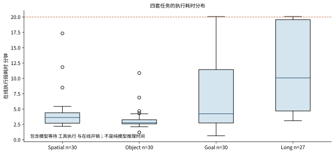
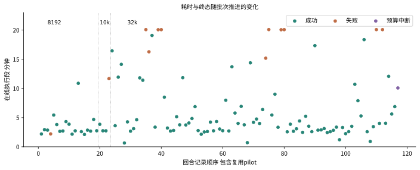
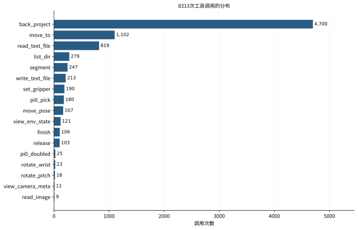
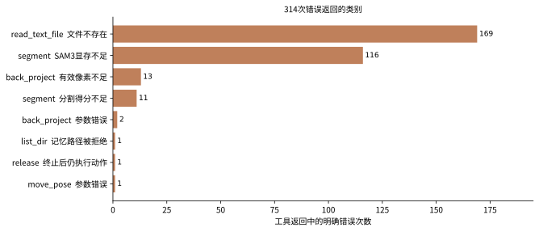

# DeepSeek 与 RPent 在 LIBERO 上的试运行分析

DeepSeek 与 RPent
在 LIBERO 上的试运行分析

终态统计  工具调用流程  仿真证据  论文协议审计

报告日期  2026年11月2日
审计对象  deepseek-batch-40usd-2026-11-01
范围  仅离线读取既有日志与仿真图像  不新增模型调用或评测回合

本批已在下一次模型请求发送前因累计40美元预算保护停止。117个已启动回合中，104个记录原生任务成功，12个任务失败，1个被预算截断；1883个计划回合未开始。

这些是真实LIBERO仿真中的系统运行结果，适合用作集成验证、失败分析和论文pilot材料。它们不能直接作为标准LIBERO总成绩或Harness VLA论文主表复现：覆盖不均、包含reference seed0、planner输出上限变化，且使用了DeepSeek与外部冻结记忆的新组合。

| 已启动 | 原生成功 | 任务失败 | 预算中断 | 未开始 |
| --- | --- | --- | --- | --- |
| 117 | 104 | 12 | 1 | 1883 |

累计费用上界  $39.668951
其中已结算保守费用 $31.903549；22笔无可信usage的请求仍保留 $7.765402 预留。该上界不是提供商账单实付。

阅读顺序  先看口径与协议，再看时间和工具结构；七个案例将模型请求、工具返回、动作状态和图像连接起来；附录给出117回合的逐项索引和复现入口。

## 一  数据范围与终态口径

本报告以events.jsonl的唯一cell身份作为回合主键，以run-summary确定UTC起止与终态，并读取同回合transcript和states。复用pilot只计算一次；它的源目录在batch外，使用事件中保存的指针读取，没有把它作为新增回合再次收费。

本次路径是RPent的API planner直接调用DeepSeek官方https://api.deepseek.com，配置模型别名deepseek-flash、reasoning high、最多100个模型turn；没有经过DSH进程。执行端采用冻结RLinf Pi0.5 LIBERO-130 SFT，读取GPT_5.5_xhigh版本的冻结记忆。模型别名背后的权重小版本没有独立固定，不能称为原论文planner的数值复现。

| 数据 | 覆盖与核验 | 能证明什么 |
| --- | --- | --- |
| 终态事件 | 117条  117个唯一cell | 104成功  12失败  1预算中断；预算中断不纳入有效完成分母 |
| transcript | 117/117可读 | 8313个tool_use；8312个对应工具返回 |
| 完整工具配对 | 116/117回合 | goal task9 seed2最后一个move_pose无返回；不推断其工具成功 |
| states | 117/117可读 | 1925条快照 = 117初态 + 1808个高层动作快照 |
| 案例 | 7回合  52个精选步骤  21张图 | 工具ID关联返回，再按step与command/result校验动作状态 |
| 费用账本 | 4068个HTTP attempt | 4046已结算；22个未知预留保留；按同一40美元上限累计 |

“有效完成”是104成功加12失败，共116回合。104/116=89.66%只描述这些已完成的混合样本；因各任务覆盖不同且配置变化，它不能写成标准LIBERO总体成功率。终态预算截断样本与1883个未开始样本均不算任务失败。

终态于2026-11-02 04:02:57 UTC写入。最后一条模型请求于04:02:35发出、04:02:48结算。04:06只读检查确认driver、最后episode、VLA与SAM3进程均已退出，服务清理退出码均为0；未发起恢复或测试请求。

证据位置  summary.json；events.jsonl；services-ed31803edc/services-summary.json；report/data/statistics.json

## 二  模型如何驱动仿真机器人

本系统不是模型一次生成一串低层控制量后直接评测。DeepSeek负责读任务、看图、检索冻结记忆并选择工具；RPent把工具请求变成感知或机器人动作，执行后返回新观测，再进入下一轮规划。

| 阶段 | 输入与调用 | 实际发生的事 |
| --- | --- | --- |
| 1 规划 | DeepSeek 生成 tool_use<br>name + JSON input + call id | 选择观察、像素定位、读记忆、解析运动或Pi0子任务；一轮可含多个工具 |
| 2 路由 | RPent toolkit 按name执行<br>API适配器携带文本和图像 | 感知工具读取已保存观测；动作工具经RPC访问唯一活跃环境 |
| 3 感知 | view_env_state / segment / back_project | 返回RGB、机器人本体状态；用SAM3掩码或可见像素的RGB-D world map得到表面三维点 |
| 4 动作 | move_to / move_pose / set_gripper / release<br>pi0_pick / pi0_doubled | 解析servo输出OSC增量控制；Pi0.5根据子指令与当前相机生成动作chunk |
| 5 反馈 | state + command + result + elapsed_s<br>terminated / truncated + artifacts | 保存动作后的仿真快照及图像；原生任务谓词反馈与局部抓取成功分开 |
| 6 再规划 | 工具结果以call id回到模型 | 模型重新看图、定位、保持夹持、搬运、释放或恢复；finish结束规划，不替代原生成功 |

高层工具频率不等于20 Hz控制频率。本地LIBERO环境默认control_freq=20 Hz，动作工具内部可执行很多底层step；VLA chunk还包含一串控制量。1200秒上限计的是planner墙钟时间，会受到模型延迟、工具及本地开销影响。

注册工具可以看到object_names、机器人末端位姿与夹爪状态，以及官方任务终止反馈；抽查没有发现planner读取GT对象中心坐标。底层raw_obs RPC的权限比planner工具更宽，尚未逐字节建立完整上游差异证明，报告不把“未见使用”夸大为形式化隔离保证。

证据位置  report/interfaces.md；rpent/tools/toolkit.py；robots/libero/{tools,env_server,env_client}.py；planner/api_loop.py

## 三  工具调用与返回长什么样

下面来自同一个成功pilot的真实请求。调用ID在完整案例JSON中保留，文本只展示决定动作的参数。像素坐标不是物体真值坐标；world_xyz由对应相机深度和标定反投影得到。

### back_project

```json
{"name": "back_project", "input": {"row": 585, "col": 765, "resolution": "high", "step": 0}}
```

返回摘要  {"step": 0, "world_xyz": [-0.1016, 0.21, 0.9185], "pixel": [585, 765]}

### move_to

```json
{"name": "move_to", "input": {"xyz": [-0.1, 0.21, 1.055], "gripper": -1, "step_clip": 0.012, "tol": 0.012, "max_steps": 100}}
```

返回摘要  {"steps_used": 70, "final_dist_m": 0.0097, "step": 1, "terminated": false, "truncated": false}

### pi0_pick

```json
{"name": "pi0_pick", "input": {"prompt": "pick up the black bowl", "max_chunks": 12, "lift_thresh": 0.05, "gripper_closed_thresh": 0.06}}
```

返回摘要  {"success": true, "chunks_used": 7, "step": 2, "terminated": false, "truncated": false}

### release

```json
{"name": "release", "input": {"max_steps": 20}}
```

返回摘要  {"steps_used": 1, "step": 7, "terminated": true, "truncated": false}

物理动作的工具返回包含step，且log.command与states.command一致。因此可以确定是哪次动作产生了哪张状态图；这一点强于只凭视频画面猜测。感知、文件工具通常不生成新动作step。

Pi0的局部success表示抓取或子技能返回条件；只有LIBERO的原生terminated才用于本报告任务成功。单个抓取成功不代表目标组合已经完成，move_to抵达目标也不等于物体成功放置。

证据位置  report/cases/cases.json；pilot online-task/transcript_spatial_t0_s0.json；同目录states.json

## 四  这能否作为论文成绩

结论是：可以作为有明确限制的pilot与过程分析，不能直接作为论文主表的协议复现。需要先选择要对齐的评测分支，再固定各项预算和接口。

| 项目 | 本次实际 | 论文或参考实现 |
| --- | --- | --- |
| 任务组成 | Spatial / Object / Goal / LIBERO-10各10任务；Long就是这里的LIBERO-10 | 与Harness论文四套任务一致 |
| 初态与种子 | 计划seed0-49；各任务实际只覆盖2或3个初态；seed0也计入记录 | Harness v5只用seed0构建记忆；seed1-10作heldout评估，共400回合 |
| 50次评测分支 | 2000是计划规模，未跑完 | OpenVLA常用实现默认每任务50次，共2000；这不是Harness论文的400协议 |
| 统一配置 | 输出cap 8192 -> 10000 -> 32000；DeepSeek planner与GPT_5.5_xhigh冻结记忆 | 应固定planner、记忆、工具及预算；DeepSeek组合应标注为新变体 |
| 时间与步数 | planner墙钟1200s；底层环境10000步；15 settling | OpenVLA参考220/280/300/520步、10 settling；Harness论文实际wall预算尚未查实 |
| 观测与动作 | RGB-D几何、解析控制与Pi0技能组合 | 这些属于Harness框架；与只输出低层动作的纯VLA榜单不是同一接口条件 |

成功判据来自原生环境：底层_check_success检查任务goal conjunction，RPent对成功信号作sticky OR，外层读取trace中的terminated。Harness v5要求预算内满足官方completion predicate，并未规定末帧仍成立，因此不能凭sticky行为断言不合规。本报告未独立逐帧重算所有任务谓词。

深度、点云派生world map、相机标定和解析动作本身不违反Harness设计。公平对比需清楚声明这些输入与工具，并使用相同权限的基线；不应把RGB-D agent的结果直接归为同预算RGB-only端到端VLA成绩。

证据位置  Harness VLA v5 Appendix C与E：https://arxiv.org/html/2607.08448v5；OpenVLA官方run_libero_eval.py；report/protocol.md

## 五  覆盖与配置变化

| 配置 | 记录 | 成功 | 失败 | 预算中断 | 已完成样本范围 |
| --- | --- | --- | --- | --- | --- |
| 8192 | 19 | 18 | 1 | 0 | seed0 spatial全部与object前9任务 |
| 10000 | 4 | 3 | 1 | 0 | seed0 object9及goal0-2 |
| 32000 | 94 | 83 | 10 | 1 | 后续任务与seed1-2的部分任务 |

| suite | 有效完成 | 成功 | 失败 | 预算中断 | 未开始 |
| --- | --- | --- | --- | --- | --- |
| Spatial | 30 | 29 | 1 | 0 | 470 |
| Object | 30 | 30 | 0 | 0 | 470 |
| Goal | 30 | 28 | 2 | 0 | 470 |
| LIBERO-10 / Long | 26 | 17 | 9 | 1 | 473 |

| seed | 成功 | 失败 | 预算中断 | 未开始 |
| --- | --- | --- | --- | --- |
| 0 | 34 | 6 | 0 | 0 |
| 1 | 36 | 4 | 0 | 0 |
| 2 | 34 | 2 | 1 | 3 |
| 3-49 | 0 | 0 | 0 | 1880 |

配置变化与任务顺序、难度和种子相互混杂。不能用8192组和32000组的样本成功率之差证明增大输出上限带来收益，也不能把较早完成的容易任务赋予更大权重后宣称总体领先。所有旧结果保留，不通过补跑失败后替换原记录来提高成功率。

证据位置  summary.json；configuration-history.json；report/data/episodes.csv

## 六  一共花了多长时间

117回合在线执行段累计44443.5秒，约12.35小时；run-summary起止差累计46145.58秒，约12.82小时。两者都包含复用pilot一次。批次调度从11月1日14:59:40至11月2日04:02:57约13.05小时，这个跨度还含暂停、启动与调度，且pilot更早发生，三种时间不能混为同一计时器。

| 终态 | n | 中位秒 | 均值秒 | P90秒 | 合计小时 |
| --- | --- | --- | --- | --- | --- |
| 成功 | 104 | 214.1 | 302.7 | 708.5 | 8.75 |
| 失败 | 12 | 1,203.8 | 1,029.5 | 1,204.6 | 3.43 |
| 预算中断 | 1 | 604.7 | 604.7 | 604.7 | 0.17 |



失败组中位数接近1200秒，主要由8次wall timeout驱动；不能据此把全部失败归为机械执行问题。P90使用离散最近秩统计，小组样本少时容易等于最大值。

## 七  耗时如何随运行推进变化



1808个动作快照的顶层elapsed_s均存在，累计1518.81秒，约25.31分钟。它反映动作执行器的计时范围，不覆盖所有感知、文件工具、模型等待与截图开销。online_elapsed减去这部分仍不能直接解释为纯LLM时间。

| 动作工具 | 动作快照 | 累计动作计时秒 | 步数或chunk证据 |
| --- | --- | --- | --- |
| move_pose | 167 | 299.54 | steps_used=14896 |
| move_to | 1102 | 672.94 | steps_used=51858 |
| pi0_doubled | 25 | 87.74 | chunks=426 |
| pi0_pick | 180 | 391.71 | chunks=1873 |
| release | 103 | 17.79 | steps_used=1257 |
| rotate_pitch | 18 | 6.86 | steps_used=318 |
| rotate_wrist | 23 | 15.15 | steps_used=715 |
| set_gripper | 190 | 27.08 | steps=1979 |

显式steps_used覆盖1410/1808动作、共69044；set_gripper的steps覆盖190条、共1979；205次Pi0调用都有chunks_used，共2299。字段语义和覆盖范围不同，不能把这些数字无条件相加为全量底层环境步数，也不能给chunk乘一个未经验证的固定长度。

证据位置  report/data/primitive_measurements.csv；statistics.json中的字段覆盖率；states.json

## 八  模型请求  缓存与费用

每episode的planner统计共有4053个模型turn，输入248987985 token、输出5800920 token，缓存输入169328896 token。输入是每次请求上下文的累计量，包含重复历史与图像token计量，不代表2.49亿独立文字。

| 口径 | 数量 | 说明 |
| --- | --- | --- |
| planner turn | 4053 | 取每回合planner_stats；可能包含已发起但没有可信返回的turn |
| 实际HTTP attempt | 4068 | 包括pilot和有记录的失败或重试尝试；不能将两者差直接当网络重试次数 |
| 已结算usage | 4046条 | prompt 249083908；output 5804312；cache hit 169342848；miss 79741060 |
| 未知usage | 22条 | 各保留最大上下文输入与32000输出的上界，不推断为零费用 |

一处重要差异：libero_10/task8/seed0在超时前最后一条HTTP已有可信结算，但未进入episode汇总，账本因此比planner合计多95923输入、3392输出及13952缓存token。不能将它解释成新增回合或无证据的网络重试。

| 费用项目 | 美元 | 计费口径 |
| --- | --- | --- |
| 已结算保守费用 | 31.903549488 | 可信usage按适用最高费率；缓存命中与未命中分别计价 |
| 未知请求保留预留 | 7.765401600 | 22 × 0.3529728；不退款、不释放 |
| 累计费用上界 | 39.668951088 | 同一持久账本，包含pilot、失败及请求尝试 |
| 余额 | 0.331048912 | 低于下一请求所需0.3529728；发送前被拒绝 |

采用的最高费率为每百万token：缓存命中输入$0.006、未命中输入$0.30、输出$1.20。请求前为最大1048576输入与32000输出保守预留，结算后按可信usage回填。此处不等于官方账单，未知请求的真实收费仍待提供商账单核对；本报告未调用余额查询API。

费用分析按串行UTC窗口对117个回合全部唯一归属，无窗口重叠；这种关联来自离线时间窗推导，账本原条目本身没有episode ID。完整规则和跨窗检查保存在analyze_budget.py与budget_analysis.json。

## 费用如何分布在不同回合

| 回合终态 | HTTP尝试 | 已结算美元 | 未知预留美元 | 费用上界美元 |
| --- | --- | --- | --- | --- |
| 预算中断 | 54 | 0.515923 | 0.000000 | 0.515923 |
| 失败 | 820 | 11.459010 | 3.176755 | 14.635765 |
| 成功 | 3194 | 19.928616 | 4.588646 | 24.517263 |

| suite | HTTP尝试 | 已结算美元 | 未知预留美元 | 费用上界美元 |
| --- | --- | --- | --- | --- |
| 10 | 1378 | 15.545743 | 3.529728 | 19.075471 |
| goal | 1082 | 9.199701 | 1.764864 | 10.964565 |
| object | 767 | 2.865676 | 1.764864 | 4.630540 |
| spatial | 841 | 4.292429 | 0.705946 | 4.998375 |

失败回合仅12个，却归属约14.64美元上界，主要因为长时间推理和恢复持续累积上下文与输出。Long套任务归属约19.08美元上界。组间费用受任务难度、已跑数量、配置和缓存命中共同影响，不能直接解释为某个工具单次调用成本。

未知请求预留也存在于成功回合；回合最终成功并不能证明之前所有HTTP请求的usage已完整返回。逐回合费用只按唯一串行窗口关联，22笔未知请求仅能确认其开始时间的回合归属，不声称知道它们的真实结算。

证据位置  report/data/budget_analysis.json；budget_attempts.csv；同一episode起止窗的完整匹配检查

## 九  哪些工具调用最多



反投影调用占一半以上，说明本系统的大量决策工作发生在视觉定位和反复采样上，而不是每个工具调用都使机器人运动。move_to共1102次；read_text_file共819次，包含记忆检索与检查。按调用量不能推断哪个工具占用最多时间，因为大部分只读工具没有独立耗时字段。

证据位置  report/data/tool_ranking.csv；tool_calls.csv；以tool_use为分母，不把工具返回消息重复计数

## 十  工具错误与行为重复



共314个明确错误返回。169次文件不存在，多数是查找记忆或文件时的失败反馈；它们不自动代表系统崩溃。SAM3共247次调用，其中116次明确CUDA OOM，另11次分割得分不足。这是可复核的感知可靠性问题；成功案例仍可能通过人工选像素与back_project完成任务。

8312条已配对返回中，7998条没有显式error，314条明确报错，另有1次调用缺返回。无error的正常返回也可能包含局部success=false，因此不能把7998直接称为工具执行目标成功次数；真实任务成功另由原生谓词判定。

还包括13次有效像素不足、2次反投影参数错误、1次记忆路径拒绝、1次终止后继续release、1次move_pose参数错误。未返回的那次move_pose不归入这314条，因为没有返回证据。

按工具名统计，相邻同名调用4910次，紧邻同名错误后再次调用94次。这些是行为重复的描述，可以是多点采样、改参数或恢复，不能直接当网络重试。现有日志未识别出明确网络重试记录，但这不能证明实际HTTP重试为零；4068条attempt才是预算层的保守请求口径。

12个任务失败的退出类别为：2次输出token上限、8次1200秒timeout、2次没有原生成功且正常结束规划。预算拒绝另列1次。物理未完成的具体原因只在有图像或状态证据时描述，不能把模型思考文本当诊断真值。

## 案例1  成功 空间关系辨认与短程放置

将盘子与小烤盅之间的黑碗拿起并放到盘上。

pick up the black bowl between the plate and the ramekin and place it on the plate

| 身份 | 终态 | 在线秒 | 模型turn | 工具调用 | 动作快照 |
| --- | --- | --- | --- | --- | --- |
| S:t0:s0 | 成功 | 131.8 | 19 | 30 | 7 |

本回合按UTC窗口归属费用上界 $0.038018；其中已结算 $0.038018，未知预留 $0.000000。

先观察多个外观相近的碗并借助像素反投影定位，接近目标后调用Pi0抓取，再保持夹持搬运到盘上、降低并释放。step 2抓取反馈成功；step 7释放时原生terminated变为true，前后图可见目标碗从原位置移到盘上。

libero_spatial_t0_s0 · 状态step 0 · agentview_high；与同编号states精确对应（本地附件或依赖，未上传：`cases/images/libero_spatial_t0_s0_step00.png`）

libero_spatial_t0_s0 · 状态step 2 · agentview_high；与同编号states精确对应（本地附件或依赖，未上传：`cases/images/libero_spatial_t0_s0_step02.png`）

libero_spatial_t0_s0 · 状态step 7 · agentview_high；与同编号states精确对应（本地附件或依赖，未上传：`cases/images/libero_spatial_t0_s0_step07.png`）

证据与局限  该条由batch events导入先导试验，源目录在batch外；不代表本批重新执行。 缺少逐工具墙钟时间戳，elapsed_s是单动作耗时，不能与视频秒数精确同步。

三张图来自同编号的agentview_high状态截图，不是根据模型描述生成的图片。截图按step精确对齐；没有逐工具墙钟时间戳，不能声称某个视频秒数与该调用精确同步。

## 案例1  请求如何变成机器人动作

| 工具与位置 | 模型给出的参数 | 机器人行为与执行反馈 |
| --- | --- | --- |
| 消息1<br>view_env_state<br>step 0 | {"step":0} | 读取当前环境状态与RGB图，确认目标、场景和是否终止。<br>返回 {"step": 0, "terminated": false, "truncated": false} |
| 消息13<br>back_project<br>step 0 | {"row":585,"col":765,"resolution":"high","step":0} | 将选定图像像素投影为三维点，辅助定位；这是感知操作，不移动机器人。<br>返回 {"step": 0, "world_xyz": [-0.1016, 0.21, 0.9185], "pixel": [585, 765]} |
| 消息20<br>move_to<br>step 1 | {"xyz":[-0.1,0.21,1.055],"gripper":-1,"step_clip":0.012,"tol":0.012,"max_steps":100} | 移动末端至指定三维目标；返回末端位置=[-0.1005, 0.2004, 1.0546]，目标残差=0.0097米。<br>返回 {"steps_used": 70, "final_dist_m": 0.0097, "step": 1, "terminated": false, "truncated": false} |
| 消息22<br>pi0_pick<br>step 2 | {"prompt":"pick up the black bowl","max_chunks":12,"lift_thresh":0.05,"gripper_closed_thresh":0.06} | 用语言指令调用Pi0执行接近、闭夹与抬升；反馈success=True。<br>返回 {"success": true, "chunks_used": 7, "step": 2, "terminated": false, "truncated": false} |
| 消息34<br>move_to<br>step 4 | {"gripper":1,"max_steps":100,"step_clip":0.012,"tol":0.012,"xyz":[0.05,0.26,1.02]} | 移动末端至指定三维目标；返回末端位置=[0.0392, 0.2597, 1.019]，目标残差=0.0108米。<br>返回 {"steps_used": 31, "final_dist_m": 0.0108, "step": 4, "terminated": false, "truncated": false} |
| 消息41<br>move_to<br>step 6 | {"gripper":1,"max_steps":80,"step_clip":0.008,"tol":0.012,"xyz":[0.0558,0.2595,0.965]} | 移动末端至指定三维目标；返回末端位置=[0.0572, 0.2604, 0.9752]，目标残差=0.0104米。<br>返回 {"steps_used": 16, "final_dist_m": 0.0104, "step": 6, "terminated": false, "truncated": false} |
| 消息43<br>release<br>step 7 | {"max_steps":20} | 张开夹爪释放物体，并读取任务终止信号。<br>返回 {"steps_used": 1, "step": 7, "terminated": true, "truncated": false} |

对齐规则  tool_use.id与tool_result.tool_call_id直接关联；动作返回的step、command、result再与states对应字段逐项核对。感知调用仅引用其请求中的既有step；该调用本身不使机器人运动。表中参数和返回按阅读长度裁剪，完整记录保存在cases.json。

证据位置  deepseek-pilot-2026-11-01-libero-spatial-t0-s0/online-task/transcript_spatial_t0_s0.json；同回合states.json；report/cases/cases.json

## 案例2  成功 包装物识别后入篮

拿起烧烤酱并放入篮中。

pick up the bbq sauce and place it in the basket

| 身份 | 终态 | 在线秒 | 模型turn | 工具调用 | 动作快照 |
| --- | --- | --- | --- | --- | --- |
| O:t3:s0 | 成功 | 155.7 | 22 | 49 | 8 |

本回合按UTC窗口归属费用上界 $0.045196；其中已结算 $0.045196，未知预留 $0.000000。

初始图中有多个瓶罐，规划器通过图像与反投影选择烧烤酱；机器人接近、Pi0抓取、闭夹保持、分段高位搬运，最后在篮口内下降释放。step 2抓取成功并使用8个chunk；step 8原生终止为true，图中瓶已在篮内。

libero_object_t3_s0 · 状态step 0 · agentview_high；与同编号states精确对应（本地附件或依赖，未上传：`cases/images/libero_object_t3_s0_step00.png`）

libero_object_t3_s0 · 状态step 2 · agentview_high；与同编号states精确对应（本地附件或依赖，未上传：`cases/images/libero_object_t3_s0_step02.png`）

libero_object_t3_s0 · 状态step 8 · agentview_high；与同编号states精确对应（本地附件或依赖，未上传：`cases/images/libero_object_t3_s0_step08.png`）

证据与局限  外观标签的判断来自RGB；不将模型关于SAM3故障的概括当作物理根因。 缺少逐工具墙钟时间戳，elapsed_s是单动作耗时，不能与视频秒数精确同步。

三张图来自同编号的agentview_high状态截图，不是根据模型描述生成的图片。截图按step精确对齐；没有逐工具墙钟时间戳，不能声称某个视频秒数与该调用精确同步。

## 案例2  请求如何变成机器人动作

| 工具与位置 | 模型给出的参数 | 机器人行为与执行反馈 |
| --- | --- | --- |
| 消息1<br>view_env_state<br>step 0 | {"step":0} | 读取当前环境状态与RGB图，确认目标、场景和是否终止。<br>返回 {"step": 0, "terminated": false, "truncated": false} |
| 消息12<br>back_project<br>step 0 | {"row":580,"col":400,"step":0} | 将选定图像像素投影为三维点，辅助定位；这是感知操作，不移动机器人。<br>返回 {"step": 0, "world_xyz": [0.0588, -0.0926, 0.0619], "pixel": [580, 400]} |
| 消息29<br>move_to<br>step 1 | {"xyz":[0.058,-0.092,0.18],"gripper":-1,"step_clip":0.02,"max_steps":100} | 移动末端至指定三维目标；返回末端位置=[0.049, -0.092, 0.1794]，目标残差=0.009米。<br>返回 {"steps_used": 45, "final_dist_m": 0.009, "step": 1, "terminated": false, "truncated": false} |
| 消息35<br>pi0_pick<br>step 2 | {"prompt":"pick up the bbq sauce","max_chunks":20,"lift_thresh":0.08,"gripper_closed_thresh":0.06} | 用语言指令调用Pi0执行接近、闭夹与抬升；反馈success=True。<br>返回 {"success": true, "chunks_used": 8, "step": 2, "terminated": false, "truncated": false} |
| 消息41<br>move_to<br>step 5 | {"gripper":1,"max_steps":80,"step_clip":0.015,"xyz":[-0.03,0.08,0.31]} | 移动末端至指定三维目标；返回末端位置=[-0.0306, 0.0681, 0.3094]，目标残差=0.0119米。<br>返回 {"steps_used": 39, "final_dist_m": 0.0119, "step": 5, "terminated": false, "truncated": false} |
| 消息62<br>move_to<br>step 7 | {"gripper":1,"max_steps":80,"step_clip":0.01,"xyz":[-0.02,0.262,0.235]} | 移动末端至指定三维目标；返回末端位置=[-0.0192, 0.2623, 0.2452]，目标残差=0.0102米。<br>返回 {"steps_used": 23, "final_dist_m": 0.0102, "step": 7, "terminated": false, "truncated": false} |
| 消息64<br>release<br>step 8 | {"max_steps":30} | 张开夹爪释放物体，并读取任务终止信号。<br>返回 {"steps_used": 8, "step": 8, "terminated": true, "truncated": false} |

对齐规则  tool_use.id与tool_result.tool_call_id直接关联；动作返回的step、command、result再与states对应字段逐项核对。感知调用仅引用其请求中的既有step；该调用本身不使机器人运动。表中参数和返回按阅读长度裁剪，完整记录保存在cases.json。

证据位置  deepseek-batch-40usd-2026-11-01/episodes/libero_object_t3_s0/online-task/transcript_object_t3_s0.json；同回合states.json；report/cases/cases.json

## 案例3  成功 双目标与多次恢复

白杯放到盘上，并将巧克力布丁放到盘右侧。

put the white mug on the plate and put the chocolate pudding to the right of the plate

| 身份 | 终态 | 在线秒 | 模型turn | 工具调用 | 动作快照 |
| --- | --- | --- | --- | --- | --- |
| L:t6:s0 | 成功 | 1,144.5 | 79 | 118 | 45 |

本回合按UTC窗口归属费用上界 $1.098564；其中已结算 $1.098564，未知预留 $0.000000。

先抓取和放置布丁，再抓杯搬到盘上。step 14释放并未完成任务，之后重定位、重抓和低速接触恢复；step 26重抓失败，step 37继续位移修正，直到step 45移动时原生terminated=true。图中末态杯明显侧倾，故仅称原生判据成功，不能据此宣称杯已直立稳定。

libero_10_t6_s0 · 状态step 0 · agentview_high；与同编号states精确对应（本地附件或依赖，未上传：`cases/images/libero_10_t6_s0_step00.png`）

libero_10_t6_s0 · 状态step 14 · agentview_high；与同编号states精确对应（本地附件或依赖，未上传：`cases/images/libero_10_t6_s0_step14.png`）

libero_10_t6_s0 · 状态step 45 · agentview_high；与同编号states精确对应（本地附件或依赖，未上传：`cases/images/libero_10_t6_s0_step45.png`）

证据与局限  恢复阶段较长，精选步骤不是全部46条状态；图像显示的姿态质量与二元成功判据不同。 缺少逐工具墙钟时间戳，elapsed_s是单动作耗时，不能与视频秒数精确同步。

三张图来自同编号的agentview_high状态截图，不是根据模型描述生成的图片。截图按step精确对齐；没有逐工具墙钟时间戳，不能声称某个视频秒数与该调用精确同步。

## 案例3  请求如何变成机器人动作

| 工具与位置 | 模型给出的参数 | 机器人行为与执行反馈 |
| --- | --- | --- |
| 消息1<br>view_env_state<br>step 0 | {"step":0} | 读取当前环境状态与RGB图，确认目标、场景和是否终止。<br>返回 {"step": 0, "terminated": false, "truncated": false} |
| 消息37<br>pi0_pick<br>step 3 | {"prompt":"pick up the chocolate pudding box","max_chunks":14,"lift_thresh":0.05} | 用语言指令调用Pi0执行接近、闭夹与抬升；反馈success=True。<br>返回 {"success": true, "chunks_used": 7, "step": 3, "terminated": false, "truncated": false} |
| 消息45<br>release<br>step 7 | {"max_steps":20} | 张开夹爪释放物体，并读取任务终止信号。<br>返回 {"steps_used": 20, "step": 7, "terminated": false, "truncated": false} |
| 消息57<br>pi0_pick<br>step 10 | {"lift_thresh":0.06,"max_chunks":15,"prompt":"grasp the white mug by the handle"} | 用语言指令调用Pi0执行接近、闭夹与抬升；反馈success=True。<br>返回 {"success": true, "chunks_used": 10, "step": 10, "terminated": false, "truncated": false} |
| 消息84<br>release<br>step 14 | {"max_steps":25} | 张开夹爪释放物体，并读取任务终止信号。<br>返回 {"steps_used": 25, "step": 14, "terminated": false, "truncated": false} |
| 消息146<br>pi0_pick<br>step 26 | {"lift_thresh":0.06,"max_chunks":12,"prompt":"grasp the white mug by the handle"} | 用语言指令调用Pi0执行接近、闭夹与抬升；反馈success=False。<br>返回 {"success": false, "chunks_used": 12, "step": 26, "terminated": false, "truncated": false} |
| 消息174<br>move_to<br>step 37 | {"action_scale":0.1,"gripper":1,"max_steps":90,"step_clip":0.006,"tol":0.015,"xyz":[0.133,-0.025,0.585]} | 移动末端至指定三维目标；返回末端位置=[0.1334, 0.0258, 0.5852]，目标残差=0.0508米。<br>返回 {"steps_used": 90, "final_dist_m": 0.0508, "step": 37, "terminated": false, "truncated": false} |
| 消息190<br>move_to<br>step 45 | {"gripper":-1,"max_steps":45,"step_clip":0.008,"tol":0.01,"xyz":[0.134,0.026,0.5]} | 移动末端至指定三维目标；返回末端位置=[0.1343, 0.0255, 0.6044]，目标残差=0.1044米。<br>返回 {"steps_used": 4, "final_dist_m": 0.1044, "step": 45, "terminated": true, "truncated": false} |

对齐规则  tool_use.id与tool_result.tool_call_id直接关联；动作返回的step、command、result再与states对应字段逐项核对。感知调用仅引用其请求中的既有step；该调用本身不使机器人运动。表中参数和返回按阅读长度裁剪，完整记录保存在cases.json。

证据位置  deepseek-batch-40usd-2026-11-01/episodes/libero_10_t6_s0/online-task/transcript_10_t6_s0.json；同回合states.json；report/cases/cases.json

## 案例4  失败 抓取未完成后输出截断

拿起饼干盒上的黑碗并放到盘上。

pick up the black bowl on the cookie box and place it on the plate

| 身份 | 终态 | 在线秒 | 模型turn | 工具调用 | 动作快照 |
| --- | --- | --- | --- | --- | --- |
| S:t3:s0 | 失败 | 132.5 | 15 | 37 | 4 |

本回合按UTC窗口归属费用上界 $0.035776；其中已结算 $0.035776，未知预留 $0.000000。

观察和反投影后，机器人连续三个位置命令接近碗，再执行8个chunk的Pi0抓取；抓取反馈success=false，最终图仍见碗在饼干盒上。随后规划器触发8192输出token上限，未生成新的完整响应；无任何原生成功终止。

libero_spatial_t3_s0 · 状态step 0 · agentview_high；与同编号states精确对应（本地附件或依赖，未上传：`cases/images/libero_spatial_t3_s0_step00.png`）

libero_spatial_t3_s0 · 状态step 3 · agentview_high；与同编号states精确对应（本地附件或依赖，未上传：`cases/images/libero_spatial_t3_s0_step03.png`）

libero_spatial_t3_s0 · 状态step 4 · agentview_high；与同编号states精确对应（本地附件或依赖，未上传：`cases/images/libero_spatial_t3_s0_step04.png`）

证据与局限  8192截断是控制流程退出原因；已有证据只支持该次抓取未完成，不把截断直接说成抓取的物理根因。 缺少逐工具墙钟时间戳，elapsed_s是单动作耗时，不能与视频秒数精确同步。

三张图来自同编号的agentview_high状态截图，不是根据模型描述生成的图片。截图按step精确对齐；没有逐工具墙钟时间戳，不能声称某个视频秒数与该调用精确同步。

## 案例4  请求如何变成机器人动作

| 工具与位置 | 模型给出的参数 | 机器人行为与执行反馈 |
| --- | --- | --- |
| 消息1<br>view_env_state<br>step 0 | {"step":0} | 读取当前环境状态与RGB图，确认目标、场景和是否终止。<br>返回 {"step": 0, "terminated": false, "truncated": false} |
| 消息4<br>back_project<br>step 0 | {"row":710,"col":528,"step":0} | 将选定图像像素投影为三维点，辅助定位；这是感知操作，不移动机器人。<br>返回 {"step": 0, "world_xyz": [0.0448, 0.0117, 0.9282], "pixel": [710, 528]} |
| 消息28<br>move_to<br>step 1 | {"xyz":[-0.02,0.012,1.12],"gripper":-1,"step_clip":0.02,"max_steps":120,"tol":0.015} | 移动末端至指定三维目标；返回末端位置=[-0.0317, 0.0121, 1.1193]，目标残差=0.0118米。<br>返回 {"steps_used": 37, "final_dist_m": 0.0118, "step": 1, "terminated": false, "truncated": false} |
| 消息35<br>move_to<br>step 2 | {"gripper":-1,"max_steps":120,"step_clip":0.015,"tol":0.012,"xyz":[0.066,0.02,1.05]} | 移动末端至指定三维目标；返回末端位置=[0.0571, 0.0201, 1.0494]，目标残差=0.0089米。<br>返回 {"steps_used": 24, "final_dist_m": 0.0089, "step": 2, "terminated": false, "truncated": false} |
| 消息43<br>move_to<br>step 3 | {"gripper":-1,"max_steps":60,"step_clip":0.012,"tol":0.01,"xyz":[0.07,0.023,1.03]} | 移动末端至指定三维目标；返回末端位置=[0.0677, 0.0218, 1.0393]，目标残差=0.0097米。<br>返回 {"steps_used": 5, "final_dist_m": 0.0097, "step": 3, "terminated": false, "truncated": false} |
| 消息45<br>pi0_pick<br>step 4 | {"lift_thresh":0.05,"max_chunks":8,"prompt":"pick up the black bowl on the cookie box","gripper_closed_thresh":0.06} | 用语言指令调用Pi0执行接近、闭夹与抬升；反馈success=False。<br>返回 {"success": false, "chunks_used": 8, "step": 4, "terminated": false, "truncated": false} |

对齐规则  tool_use.id与tool_result.tool_call_id直接关联；动作返回的step、command、result再与states对应字段逐项核对。感知调用仅引用其请求中的既有step；该调用本身不使机器人运动。表中参数和返回按阅读长度裁剪，完整记录保存在cases.json。

证据位置  deepseek-batch-40usd-2026-11-01/episodes/libero_spatial_t3_s0/online-task/transcript_spatial_t3_s0.json；同回合states.json；report/cases/cases.json

## 案例5  失败 长时间恢复最终超时

白杯放左盘，黄白杯放右盘。

put the white mug on the left plate and put the yellow and white mug on the right plate

| 身份 | 终态 | 在线秒 | 模型turn | 工具调用 | 动作快照 |
| --- | --- | --- | --- | --- | --- |
| L:t4:s0 | 失败 | 1,204.4 | 84 | 132 | 46 |

本回合按UTC窗口归属费用上界 $1.464158；其中已结算 $1.111185，未知预留 $0.352973。

机器人先抓黄白杯并尝试横移、下降和释放，随后对白杯反复接近、抓取及位姿调整。早期Pi0局部抓取可成功，但后续多次白杯抓取失败；最后step 46抓取success=false。规划器运行达到1200秒限制退出，47条状态均未给出任务成功终止。

libero_10_t4_s0 · 状态step 0 · agentview_high；与同编号states精确对应（本地附件或依赖，未上传：`cases/images/libero_10_t4_s0_step00.png`）

libero_10_t4_s0 · 状态step 10 · agentview_high；与同编号states精确对应（本地附件或依赖，未上传：`cases/images/libero_10_t4_s0_step10.png`）

libero_10_t4_s0 · 状态step 46 · agentview_high；与同编号states精确对应（本地附件或依赖，未上传：`cases/images/libero_10_t4_s0_step46.png`）

证据与局限  超时是运行退出原因，不证明唯一物理障碍；局部pick成功也不等于两个目标同时满足。 缺少逐工具墙钟时间戳，elapsed_s是单动作耗时，不能与视频秒数精确同步。

三张图来自同编号的agentview_high状态截图，不是根据模型描述生成的图片。截图按step精确对齐；没有逐工具墙钟时间戳，不能声称某个视频秒数与该调用精确同步。

## 案例5  请求如何变成机器人动作

| 工具与位置 | 模型给出的参数 | 机器人行为与执行反馈 |
| --- | --- | --- |
| 消息1<br>view_env_state<br>step 0 | {"step":0} | 读取当前环境状态与RGB图，确认目标、场景和是否终止。<br>返回 {"step": 0, "terminated": false, "truncated": false} |
| 消息12<br>back_project<br>step 0 | {"row":670,"col":40,"step":0} | 将选定图像像素投影为三维点，辅助定位；这是感知操作，不移动机器人。<br>返回 {"step": 0, "world_xyz": [-0.0249, -0.3086, 0.4448], "pixel": [670, 40]} |
| 消息33<br>pi0_pick<br>step 2 | {"prompt":"grasp the yellow mug by the handle loop","max_chunks":8,"lift_thresh":0.05,"gripper_closed_thresh":0.06} | 用语言指令调用Pi0执行接近、闭夹与抬升；反馈success=True。<br>返回 {"success": true, "chunks_used": 8, "step": 2, "terminated": false, "truncated": false} |
| 消息67<br>move_to<br>step 9 | {"gripper":1,"max_steps":120,"step_clip":0.004,"tol":0.006,"xyz":[-0.012,-0.27,0.576]} | 移动末端至指定三维目标；返回末端位置=[-0.0118, -0.2699, 0.5813]，目标残差=0.0053米。<br>返回 {"steps_used": 53, "final_dist_m": 0.0053, "step": 9, "terminated": false, "truncated": false} |
| 消息74<br>move_to<br>step 10 | {"gripper":1,"max_steps":40,"step_clip":0.003,"tol":0.006,"xyz":[-0.012,-0.272,0.566]} | 移动末端至指定三维目标；返回末端位置=[-0.0121, -0.2718, 0.5714]，目标残差=0.0054米。<br>返回 {"steps_used": 13, "final_dist_m": 0.0054, "step": 10, "terminated": false, "truncated": false} |
| 消息128<br>move_to<br>step 23 | {"gripper":1,"max_steps":70,"step_clip":0.004,"tol":0.007,"xyz":[0.001,0.358,0.635]} | 移动末端至指定三维目标；返回末端位置=[0.0009, 0.3578, 0.6417]，目标残差=0.0067米。<br>返回 {"steps_used": 17, "final_dist_m": 0.0067, "step": 23, "terminated": false, "truncated": false} |
| 消息178<br>pi0_pick<br>step 36 | {"gripper_closed_thresh":0.06,"lift_thresh":0.05,"max_chunks":8,"prompt":"grasp the white mug by the handle"} | 用语言指令调用Pi0执行接近、闭夹与抬升；反馈success=False。<br>返回 {"success": false, "chunks_used": 8, "step": 36, "terminated": false, "truncated": false} |
| 消息211<br>pi0_pick<br>step 46 | {"gripper_closed_thresh":0.06,"lift_thresh":0.05,"max_chunks":14,"prompt":"grasp the white mug by the handle"} | 用语言指令调用Pi0执行接近、闭夹与抬升；反馈success=False。<br>返回 {"success": false, "chunks_used": 14, "step": 46, "terminated": false, "truncated": false} |

对齐规则  tool_use.id与tool_result.tool_call_id直接关联；动作返回的step、command、result再与states对应字段逐项核对。感知调用仅引用其请求中的既有step；该调用本身不使机器人运动。表中参数和返回按阅读长度裁剪，完整记录保存在cases.json。

证据位置  deepseek-batch-40usd-2026-11-01/episodes/libero_10_t4_s0/online-task/transcript_10_t4_s0.json；同回合states.json；report/cases/cases.json

## 案例6  失败 放碗后关抽屉未完成

把黑碗放进柜子底层抽屉并关闭抽屉。

put the black bowl in the bottom drawer of the cabinet and close it

| 身份 | 终态 | 在线秒 | 模型turn | 工具调用 | 动作快照 |
| --- | --- | --- | --- | --- | --- |
| L:t3:s1 | 失败 | 910.7 | 61 | 122 | 34 |

本回合按UTC窗口归属费用上界 $0.806370；其中已结算 $0.806370，未知预留 $0.000000。

机器人先抓碗并搬到打开的底层抽屉处，step 14释放。随后通过多种俯仰角和推送路径尝试关抽屉，step 28还调用接触技能pi0_doubled；该技能返回task_success=false，末态抽屉仍有开口，原生terminated始终false。规划器主动以stuck结束。

libero_10_t3_s1 · 状态step 0 · agentview_high；与同编号states精确对应（本地附件或依赖，未上传：`cases/images/libero_10_t3_s1_step00.png`）

libero_10_t3_s1 · 状态step 14 · agentview_high；与同编号states精确对应（本地附件或依赖，未上传：`cases/images/libero_10_t3_s1_step14.png`）

libero_10_t3_s1 · 状态step 34 · agentview_high；与同编号states精确对应（本地附件或依赖，未上传：`cases/images/libero_10_t3_s1_step34.png`）

证据与局限  状态只保存末端与夹爪等观测，缺少抽屉关节/接触力真值；不能断言碗卡住抽屉或确定碰撞部位。 缺少逐工具墙钟时间戳，elapsed_s是单动作耗时，不能与视频秒数精确同步。

三张图来自同编号的agentview_high状态截图，不是根据模型描述生成的图片。截图按step精确对齐；没有逐工具墙钟时间戳，不能声称某个视频秒数与该调用精确同步。

## 案例6  请求如何变成机器人动作

| 工具与位置 | 模型给出的参数 | 机器人行为与执行反馈 |
| --- | --- | --- |
| 消息1<br>view_env_state<br>step 0 | {"step":0} | 读取当前环境状态与RGB图，确认目标、场景和是否终止。<br>返回 {"step": 0, "terminated": false, "truncated": false} |
| 消息64<br>pi0_pick<br>step 7 | {"prompt":"pick up the black bowl","max_chunks":10,"lift_thresh":0.05,"gripper_closed_thresh":0.06} | 用语言指令调用Pi0执行接近、闭夹与抬升；反馈success=True。<br>返回 {"success": true, "chunks_used": 7, "step": 7, "terminated": false, "truncated": false} |
| 消息97<br>move_pose<br>step 13 | {"gripper":1,"max_steps":140,"pitch_step":0.05,"step_clip":0.008,"target_pitch":0.3,"target_yaw":0,"tol":0.01,"xyz":[0.012,0.19,1.0]} | 同时调整末端位置和俯仰姿态；返回位置=[0.0128, 0.1681, 1.0813]，目标残差=0.0842米。<br>返回 {"steps_used": 140, "final_dist_m": 0.0842, "step": 13, "terminated": false, "truncated": false} |
| 消息104<br>release<br>step 14 | {"max_steps":25} | 张开夹爪释放物体，并读取任务终止信号。<br>返回 {"steps_used": 25, "step": 14, "terminated": false, "truncated": false} |
| 消息119<br>move_pose<br>step 19 | {"gripper":1,"max_steps":110,"pitch_step":0.06,"step_clip":0.006,"target_pitch":0.9,"target_yaw":0,"tol":0.012,"xyz":[0.01,0.14,0.97]} | 同时调整末端位置和俯仰姿态；返回位置=[0.0117, 0.1157, 0.9722]，目标残差=0.0245米。<br>返回 {"steps_used": 110, "final_dist_m": 0.0245, "step": 19, "terminated": false, "truncated": false} |
| 消息136<br>move_pose<br>step 22 | {"gripper":1,"max_steps":200,"pitch_step":0.05,"step_clip":0.006,"target_pitch":1.6,"target_yaw":0,"tol":0.01,"xyz":[0.01,0.22,0.945]} | 同时调整末端位置和俯仰姿态；返回位置=[0.0133, 0.1296, 1.0015]，目标残差=0.1066米。<br>返回 {"steps_used": 200, "final_dist_m": 0.1066, "step": 22, "terminated": false, "truncated": false} |
| 消息161<br>pi0_doubled<br>step 28 | {"max_chunks":12,"prompt":"close the bottom drawer of the cabinet"} | 调用接触技能尝试关闭抽屉；反馈task_success=False。<br>返回 {"success": false, "task_success": false, "chunks_used": 12, "step": 28, "terminated": false, "truncated": false} |
| 消息176<br>move_to<br>step 34 | {"action_scale":0.3,"gripper":1,"max_steps":60,"step_clip":0.03,"tol":0.008,"xyz":[0.03,0.24,0.99]} | 移动末端至指定三维目标；返回末端位置=[0.0332, 0.0877, 1.0092]，目标残差=0.1536米。<br>返回 {"steps_used": 60, "final_dist_m": 0.1536, "step": 34, "terminated": false, "truncated": false} |

对齐规则  tool_use.id与tool_result.tool_call_id直接关联；动作返回的step、command、result再与states对应字段逐项核对。感知调用仅引用其请求中的既有step；该调用本身不使机器人运动。表中参数和返回按阅读长度裁剪，完整记录保存在cases.json。

证据位置  deepseek-batch-40usd-2026-11-01/episodes/libero_10_t3_s1/online-task/transcript_10_t3_s1.json；同回合states.json；report/cases/cases.json

## 案例7  预算中断 进行中的双目标任务

白杯放到盘上，并将巧克力布丁放到盘右侧。

put the white mug on the plate and put the chocolate pudding to the right of the plate

| 身份 | 终态 | 在线秒 | 模型turn | 工具调用 | 动作快照 |
| --- | --- | --- | --- | --- | --- |
| L:t6:s2 | 预算中断 | 604.7 | 55 | 86 | 26 |

本回合按UTC窗口归属费用上界 $0.515923；其中已结算 $0.515923，未知预留 $0.000000。

先抓取布丁并释放，再尝试抓白杯、搬运和释放。step 10、19的抓取反馈失败，step 22的局部抓取反馈成功，之后继续位姿调整；step 26后尚无成功终止，图中杯侧倒于盘边。下一次HTTP发送前预算预留检查拒绝请求，因此没有后续动作，不能把它解释成已证明的最终物理失败。

libero_10_t6_s2 · 状态step 0 · agentview_high；与同编号states精确对应（本地附件或依赖，未上传：`cases/images/libero_10_t6_s2_step00.png`）

libero_10_t6_s2 · 状态step 14 · agentview_high；与同编号states精确对应（本地附件或依赖，未上传：`cases/images/libero_10_t6_s2_step14.png`）

libero_10_t6_s2 · 状态step 26 · agentview_high；与同编号states精确对应（本地附件或依赖，未上传：`cases/images/libero_10_t6_s2_step26.png`）

证据与局限  退出错误记录已记账39.668951088美元，加下一请求预留0.3529728美元超过40美元上限；这是预算截断样本。 缺少逐工具墙钟时间戳，elapsed_s是单动作耗时，不能与视频秒数精确同步。

三张图来自同编号的agentview_high状态截图，不是根据模型描述生成的图片。截图按step精确对齐；没有逐工具墙钟时间戳，不能声称某个视频秒数与该调用精确同步。

## 案例7  请求如何变成机器人动作

| 工具与位置 | 模型给出的参数 | 机器人行为与执行反馈 |
| --- | --- | --- |
| 消息1<br>view_env_state<br>step 0 | {"step":0} | 读取当前环境状态与RGB图，确认目标、场景和是否终止。<br>返回 {"step": 0, "terminated": false, "truncated": false} |
| 消息32<br>pi0_pick<br>step 2 | {"prompt":"pick up the chocolate pudding box","max_chunks":14,"lift_thresh":0.05} | 用语言指令调用Pi0执行接近、闭夹与抬升；反馈success=True。<br>返回 {"success": true, "chunks_used": 7, "step": 2, "terminated": false, "truncated": false} |
| 消息43<br>release<br>step 6 | {"max_steps":15} | 张开夹爪释放物体，并读取任务终止信号。<br>返回 {"steps_used": 15, "step": 6, "terminated": false, "truncated": false} |
| 消息54<br>pi0_pick<br>step 10 | {"lift_thresh":0.05,"max_chunks":12,"prompt":"grasp the white mug"} | 用语言指令调用Pi0执行接近、闭夹与抬升；反馈success=False。<br>返回 {"success": false, "chunks_used": 12, "step": 10, "terminated": false, "truncated": false} |
| 消息71<br>release<br>step 14 | {"max_steps":20} | 张开夹爪释放物体，并读取任务终止信号。<br>返回 {"steps_used": 20, "step": 14, "terminated": false, "truncated": false} |
| 消息102<br>pi0_pick<br>step 19 | {"lift_thresh":0.05,"max_chunks":12,"prompt":"grasp the white mug"} | 用语言指令调用Pi0执行接近、闭夹与抬升；反馈success=False。<br>返回 {"success": false, "chunks_used": 12, "step": 19, "terminated": false, "truncated": false} |
| 消息115<br>pi0_pick<br>step 22 | {"lift_thresh":0.05,"max_chunks":14,"prompt":"grasp the white mug by the handle"} | 用语言指令调用Pi0执行接近、闭夹与抬升；反馈success=True。<br>返回 {"success": true, "chunks_used": 14, "step": 22, "terminated": false, "truncated": false} |
| 消息136<br>move_to<br>step 26 | {"gripper":1,"max_steps":80,"step_clip":0.02,"xyz":[0.0,0.055,0.62]} | 移动末端至指定三维目标；返回末端位置=[-0.0022, 0.0545, 0.6317]，目标残差=0.0119米。<br>返回 {"steps_used": 30, "final_dist_m": 0.0119, "step": 26, "terminated": false, "truncated": false} |

对齐规则  tool_use.id与tool_result.tool_call_id直接关联；动作返回的step、command、result再与states对应字段逐项核对。感知调用仅引用其请求中的既有step；该调用本身不使机器人运动。表中参数和返回按阅读长度裁剪，完整记录保存在cases.json。

证据位置  deepseek-batch-40usd-2026-11-01/episodes/libero_10_t6_s2/online-task/transcript_10_t6_s2.json；同回合states.json；report/cases/cases.json

## 十一  从这些证据可以改进什么

第一步是把正式评测协议固定下来。若目标是Harness论文，采用40任务各10个heldout seed并排除reference seed0；统一planner版本、冻结记忆、工具权限、输出与步数预算，先查明目标论文的真实时间设置。DeepSeek作为独立变体报告。若目标是纯VLA比较，另用同观测、低层动作接口和suite horizon评测，不能直接搬用本系统成功率。

第二步是修复感知可靠性并减少重复定位成本。116次明确SAM3 OOM值得单独定位显存峰值与输入策略；4700次反投影可评估批量像素查询和已有点位复用。后续应以同任务、同初态和固定预算做单变量对比，同时记录失败恢复率、模型turn、费用及墙钟耗时。现有批次不再改动或补跑后替换结果。

第三步是改善事件记录。将episode ID直接写入每次HTTP attempt，给所有工具请求/返回增加单调时钟起止、底层action计数与视频时间索引，并在timeout时保留最后未返回调用的状态。这样才能可靠分解模型等待、感知、机器人执行和采集开销，重建精确的模型到视频时间线。

本次已经验证了工具链能形成闭环，也定位到输出预算、wall timeout、局部抓取与任务完成不一致、感知OOM等不同层的问题。它尚不能证明相对某论文或榜单方法的性能优势；后续主张应依赖固定协议下完整、平衡的任务覆盖。

## 十二  复现统计与材料索引

所有分析均离线完成，输出位于本批次独立report目录。原始运行日志、预算账本、运行源码和其他项目未被修改；预算停止后没有新增模型调用、仿真或训练。复现脚本只读取既有日志，写入report派生文件。

| 文件 | 用途 |
| --- | --- |
| scripts/analyze_statistics.py | 去重回合、工具ID配对、用时与usage、显式动作计数；标准库 |
| scripts/analyze_budget.py | 请求费用、未知预留、时间窗归属与usage差异；标准库 |
| scripts/analyze_cases.py | 抽取7案的请求/返回/状态与21张既有图像 |
| scripts/make_figures.py | 生成4组PNG与SVG统计图；matplotlib |
| scripts/build_report.py | 由同一结构化材料生成中文Markdown和本PDF；ReportLab |
| data/episodes.csv | 117回合逐项UTC时间、在线耗时、turn、tokens、工具与动作计数 |
| data/tool_calls.csv 与 tool_ranking.csv | 8313条去敏调用结构及按工具汇总；不含原始大正文或鉴权 |
| data/budget_attempts.csv 与 budget_analysis.json | 4068次attempt安全元数据、费用构成及关联覆盖率 |
| data/primitive_measurements.csv | 1808动作的显式耗时、steps与chunks字段及缺失口径 |
| cases/cases.json 与 cases/images | 7案52个精选步骤及21张原始状态截图副本 |
| protocol.md 与 interfaces.md | 论文协议、观测动作接口与未验证边界的源码证据 |

最小复现顺序  先运行analyze_statistics.py、analyze_budget.py、analyze_cases.py，再运行make_figures.py与build_report.py。具体命令与依赖保存在REPRODUCE.md。所有脚本均不启动benchmark；不要用本报告中的材料目录作为resume入口。

## 附录  117个已启动回合的用时与调用

身份缩写 S=Spatial，O=Object，G=Goal，L=LIBERO-10；t为任务，s为初态seed。配置1/2/3对应8192/10000/32000输出cap。“请求”列为planner turn，不是HTTP attempt。每回合更完整数据见episodes.csv。

| 任务 | 配置 | 终态 | 在线秒 | 请求 | 工具 | 动作 | 错误 | 费用上界 |
| --- | --- | --- | --- | --- | --- | --- | --- | --- |
| S:t0:s0 | v1 | 成功 | 131.8 | 19 | 30 | 7 | 1 | 0.0380 |
| S:t1:s0 | v1 | 成功 | 176.1 | 23 | 50 | 8 | 1 | 0.0505 |
| S:t2:s0 | v1 | 成功 | 171.2 | 23 | 50 | 6 | 2 | 0.0608 |
| S:t3:s0 | v1 | 失败 | 132.5 | 15 | 37 | 4 | 3 | 0.0358 |
| S:t4:s0 | v1 | 成功 | 326.1 | 28 | 75 | 11 | 2 | 0.1444 |
| S:t5:s0 | v1 | 成功 | 228.5 | 21 | 61 | 9 | 1 | 0.0629 |
| S:t6:s0 | v1 | 成功 | 158.7 | 20 | 51 | 8 | 1 | 0.0461 |
| S:t7:s0 | v1 | 成功 | 162.7 | 24 | 53 | 9 | 3 | 0.0620 |
| S:t8:s0 | v1 | 成功 | 258.8 | 30 | 76 | 10 | 4 | 0.1234 |
| S:t9:s0 | v1 | 成功 | 232.0 | 28 | 75 | 10 | 1 | 0.1243 |
| O:t0:s0 | v1 | 成功 | 129.8 | 24 | 43 | 8 | 3 | 0.0537 |
| O:t1:s0 | v1 | 成功 | 163.9 | 22 | 47 | 8 | 3 | 0.0460 |
| O:t2:s0 | v1 | 成功 | 652.6 | 58 | 122 | 31 | 6 | 0.5795 |
| O:t3:s0 | v1 | 成功 | 155.7 | 22 | 49 | 8 | 3 | 0.0452 |
| O:t4:s0 | v1 | 成功 | 126.8 | 19 | 35 | 9 | 1 | 0.0382 |
| O:t5:s0 | v1 | 成功 | 170.7 | 23 | 46 | 7 | 3 | 0.0609 |
| O:t6:s0 | v1 | 成功 | 161.0 | 23 | 48 | 10 | 3 | 0.0591 |
| O:t7:s0 | v1 | 成功 | 280.6 | 33 | 54 | 15 | 2 | 0.1600 |
| O:t8:s0 | v1 | 成功 | 164.8 | 24 | 43 | 10 | 1 | 0.0750 |
| O:t9:s0 | v2 | 成功 | 231.2 | 22 | 49 | 9 | 1 | 0.0591 |
| G:t0:s0 | v2 | 成功 | 164.6 | 16 | 44 | 4 | 1 | 0.0457 |
| G:t1:s0 | v2 | 成功 | 164.2 | 24 | 56 | 7 | 2 | 0.0623 |
| G:t2:s0 | v2 | 失败 | 700.6 | 46 | 93 | 17 | 7 | 0.4256 |
| G:t3:s0 | v3 | 成功 | 986.2 | 66 | 162 | 26 | 6 | 0.7385 |
| G:t4:s0 | v3 | 成功 | 216.6 | 22 | 67 | 7 | 2 | 0.0625 |
| G:t5:s0 | v3 | 成功 | 715.7 | 61 | 88 | 32 | 4 | 0.9886 |
| G:t6:s0 | v3 | 成功 | 847.5 | 74 | 141 | 36 | 8 | 1.0841 |
| G:t7:s0 | v3 | 成功 | 39.0 | 9 | 18 | 1 | 2 | 0.0171 |
| G:t8:s0 | v3 | 成功 | 256.2 | 32 | 55 | 14 | 3 | 0.1548 |
| G:t9:s0 | v3 | 成功 | 160.5 | 21 | 47 | 7 | 1 | 0.0472 |

## 附录  回合索引续表

| 任务 | 配置 | 终态 | 在线秒 | 请求 | 工具 | 动作 | 错误 | 费用上界 |
| --- | --- | --- | --- | --- | --- | --- | --- | --- |
| L:t0:s0 | v3 | 成功 | 185.9 | 25 | 43 | 12 | 4 | 0.0968 |
| L:t1:s0 | v3 | 成功 | 277.7 | 37 | 63 | 20 | 3 | 0.2453 |
| L:t2:s0 | v3 | 成功 | 708.5 | 48 | 96 | 24 | 6 | 0.5765 |
| L:t3:s0 | v3 | 成功 | 684.0 | 48 | 106 | 23 | 3 | 0.5324 |
| L:t4:s0 | v3 | 失败 | 1,204.4 | 84 | 132 | 46 | 3 | 1.4642 |
| L:t5:s0 | v3 | 失败 | 976.5 | 67 | 145 | 39 | 3 | 1.2733 |
| L:t6:s0 | v3 | 成功 | 1,144.5 | 79 | 118 | 45 | 5 | 1.0986 |
| L:t7:s0 | v3 | 成功 | 201.8 | 29 | 62 | 13 | 4 | 0.1582 |
| L:t8:s0 | v3 | 失败 | 1,203.5 | 88 | 168 | 47 | 3 | 1.2842 |
| L:t9:s0 | v3 | 失败 | 1,204.1 | 86 | 155 | 56 | 4 | 1.6211 |
| S:t0:s1 | v3 | 成功 | 509.7 | 32 | 89 | 12 | 2 | 0.3149 |
| S:t1:s1 | v3 | 成功 | 192.8 | 23 | 50 | 9 | 1 | 0.4062 |
| S:t2:s1 | v3 | 成功 | 161.8 | 20 | 51 | 7 | 3 | 0.0473 |
| S:t3:s1 | v3 | 成功 | 167.9 | 21 | 60 | 8 | 3 | 0.0496 |
| S:t4:s1 | v3 | 成功 | 308.4 | 28 | 85 | 11 | 4 | 0.1391 |
| S:t5:s1 | v3 | 成功 | 225.7 | 27 | 64 | 8 | 4 | 0.4616 |
| S:t6:s1 | v3 | 成功 | 710.1 | 62 | 103 | 32 | 5 | 0.5966 |
| S:t7:s1 | v3 | 成功 | 224.3 | 31 | 63 | 11 | 3 | 0.1482 |
| S:t8:s1 | v3 | 成功 | 244.6 | 28 | 50 | 10 | 2 | 0.1639 |
| S:t9:s1 | v3 | 成功 | 290.6 | 33 | 90 | 12 | 4 | 0.1712 |
| O:t0:s1 | v3 | 成功 | 412.5 | 43 | 69 | 19 | 2 | 0.2844 |
| O:t1:s1 | v3 | 成功 | 166.5 | 25 | 46 | 8 | 4 | 0.4314 |
| O:t2:s1 | v3 | 成功 | 128.9 | 18 | 49 | 5 | 2 | 0.0391 |
| O:t3:s1 | v3 | 成功 | 152.6 | 26 | 52 | 8 | 3 | 0.0756 |
| O:t4:s1 | v3 | 成功 | 156.9 | 25 | 54 | 9 | 2 | 0.0645 |
| O:t5:s1 | v3 | 成功 | 253.8 | 30 | 60 | 12 | 2 | 0.4782 |
| O:t6:s1 | v3 | 成功 | 164.3 | 27 | 58 | 8 | 5 | 0.0963 |
| O:t7:s1 | v3 | 成功 | 259.4 | 30 | 57 | 13 | 5 | 0.1680 |
| O:t8:s1 | v3 | 成功 | 182.7 | 25 | 57 | 8 | 3 | 0.4334 |
| O:t9:s1 | v3 | 成功 | 165.3 | 24 | 50 | 10 | 2 | 0.0689 |

## 附录  回合索引续表

| 任务 | 配置 | 终态 | 在线秒 | 请求 | 工具 | 动作 | 错误 | 费用上界 |
| --- | --- | --- | --- | --- | --- | --- | --- | --- |
| G:t0:s1 | v3 | 成功 | 478.5 | 27 | 76 | 11 | 3 | 0.2542 |
| G:t1:s1 | v3 | 成功 | 162.6 | 27 | 56 | 10 | 1 | 0.0893 |
| G:t2:s1 | v3 | 成功 | 822.5 | 65 | 141 | 32 | 1 | 0.7940 |
| G:t3:s1 | v3 | 成功 | 347.0 | 40 | 87 | 13 | 4 | 0.2319 |
| G:t4:s1 | v3 | 成功 | 240.1 | 26 | 63 | 7 | 1 | 0.1013 |
| G:t5:s1 | v3 | 成功 | 415.3 | 35 | 82 | 16 | 2 | 0.2646 |
| G:t6:s1 | v3 | 成功 | 226.0 | 30 | 66 | 10 | 4 | 0.1386 |
| G:t7:s1 | v3 | 成功 | 42.4 | 9 | 19 | 1 | 3 | 0.0150 |
| G:t8:s1 | v3 | 成功 | 862.9 | 58 | 112 | 33 | 2 | 0.8470 |
| G:t9:s1 | v3 | 成功 | 251.5 | 23 | 55 | 10 | 4 | 0.0830 |
| L:t0:s1 | v3 | 成功 | 285.3 | 35 | 60 | 17 | 2 | 0.1886 |
| L:t1:s1 | v3 | 成功 | 239.7 | 35 | 59 | 19 | 1 | 0.2294 |
| L:t2:s1 | v3 | 成功 | 382.7 | 34 | 77 | 14 | 3 | 0.2548 |
| L:t3:s1 | v3 | 失败 | 910.7 | 61 | 122 | 34 | 2 | 0.8064 |
| L:t4:s1 | v3 | 失败 | 1,204.8 | 82 | 166 | 42 | 6 | 1.4074 |
| L:t5:s1 | v3 | 成功 | 326.4 | 27 | 89 | 10 | 3 | 0.1602 |
| L:t6:s1 | v3 | 成功 | 540.4 | 51 | 96 | 21 | 6 | 0.3332 |
| L:t7:s1 | v3 | 成功 | 200.5 | 31 | 62 | 14 | 1 | 0.1304 |
| L:t8:s1 | v3 | 失败 | 1,203.3 | 66 | 114 | 39 | 2 | 1.5385 |
| L:t9:s1 | v3 | 失败 | 1,204.1 | 72 | 146 | 44 | 3 | 2.1818 |
| S:t0:s2 | v3 | 成功 | 153.9 | 27 | 46 | 6 | 3 | 0.0905 |
| S:t1:s2 | v3 | 成功 | 231.9 | 26 | 59 | 11 | 1 | 0.0997 |
| S:t2:s2 | v3 | 成功 | 159.3 | 21 | 37 | 9 | 2 | 0.0420 |
| S:t3:s2 | v3 | 成功 | 184.7 | 24 | 50 | 11 | 3 | 0.0820 |
| S:t4:s2 | v3 | 成功 | 265.2 | 31 | 71 | 11 | 4 | 0.1389 |
| S:t5:s2 | v3 | 成功 | 148.5 | 20 | 44 | 8 | 2 | 0.0405 |
| S:t6:s2 | v3 | 成功 | 313.7 | 39 | 72 | 18 | 1 | 0.2418 |
| S:t7:s2 | v3 | 成功 | 211.5 | 31 | 54 | 9 | 2 | 0.1324 |
| S:t8:s2 | v3 | 成功 | 155.4 | 26 | 61 | 8 | 1 | 0.0698 |
| S:t9:s2 | v3 | 成功 | 1,039.8 | 58 | 120 | 27 | 4 | 0.8139 |

## 附录  回合索引续表

| 任务 | 配置 | 终态 | 在线秒 | 请求 | 工具 | 动作 | 错误 | 费用上界 |
| --- | --- | --- | --- | --- | --- | --- | --- | --- |
| O:t0:s2 | v3 | 成功 | 170.8 | 19 | 36 | 5 | 4 | 0.3926 |
| O:t1:s2 | v3 | 成功 | 173.8 | 22 | 46 | 7 | 2 | 0.3928 |
| O:t2:s2 | v3 | 成功 | 187.2 | 24 | 54 | 8 | 2 | 0.0802 |
| O:t3:s2 | v3 | 成功 | 146.6 | 19 | 36 | 8 | 1 | 0.0397 |
| O:t4:s2 | v3 | 成功 | 155.1 | 25 | 48 | 11 | 1 | 0.0881 |
| O:t5:s2 | v3 | 成功 | 169.3 | 21 | 41 | 8 | 1 | 0.0429 |
| O:t6:s2 | v3 | 成功 | 201.7 | 29 | 59 | 12 | 1 | 0.0999 |
| O:t7:s2 | v3 | 成功 | 72.6 | 13 | 24 | 3 | 1 | 0.0225 |
| O:t8:s2 | v3 | 成功 | 198.0 | 28 | 55 | 10 | 2 | 0.1180 |
| O:t9:s2 | v3 | 成功 | 134.9 | 19 | 43 | 8 | 1 | 0.0373 |
| G:t0:s2 | v3 | 成功 | 155.6 | 18 | 45 | 4 | 1 | 0.0402 |
| G:t1:s2 | v3 | 成功 | 210.4 | 31 | 57 | 8 | 3 | 0.4574 |
| G:t2:s2 | v3 | 成功 | 642.2 | 39 | 89 | 21 | 2 | 0.4214 |
| G:t3:s2 | v3 | 成功 | 473.6 | 33 | 100 | 12 | 3 | 0.2352 |
| G:t4:s2 | v3 | 成功 | 316.9 | 33 | 51 | 10 | 4 | 0.1525 |
| G:t5:s2 | v3 | 成功 | 1,101.3 | 76 | 107 | 52 | 4 | 1.8485 |
| G:t6:s2 | v3 | 成功 | 154.9 | 20 | 40 | 7 | 2 | 0.0387 |
| G:t7:s2 | v3 | 成功 | 54.6 | 10 | 20 | 1 | 3 | 0.0171 |
| G:t8:s2 | v3 | 成功 | 207.1 | 29 | 76 | 10 | 2 | 0.1066 |
| G:t9:s2 | v3 | 失败 | 1,204.6 | 77 | 147 | 50 | 1 | 1.2015 |
| L:t0:s2 | v3 | 成功 | 240.8 | 27 | 57 | 14 | 3 | 0.1223 |
| L:t1:s2 | v3 | 失败 | 1,204.3 | 73 | 110 | 45 | 1 | 1.3961 |
| L:t2:s2 | v3 | 成功 | 241.8 | 29 | 61 | 12 | 3 | 0.1168 |
| L:t3:s2 | v3 | 成功 | 724.4 | 44 | 102 | 20 | 2 | 0.5303 |
| L:t4:s2 | v3 | 成功 | 336.7 | 37 | 58 | 20 | 2 | 0.6097 |
| L:t5:s2 | v3 | 成功 | 412.7 | 25 | 93 | 8 | 1 | 0.2031 |
| L:t6:s2 | v3 | 预算中断 | 604.7 | 55 | 86 | 26 | 4 | 0.5159 |

## 参考与统计边界

1 Harness VLA Steering Frozen VLAs into Reliable Manipulation Primitives via Memory Guided Agents，arXiv 2607.08448v5，Appendix C与E。https://arxiv.org/html/2607.08448v5

2 LIBERO官方仓库。https://github.com/Lifelong-Robot-Learning/LIBERO

3 OpenVLA官方评测代码。https://github.com/openvla/openvla/blob/main/experiments/robot/libero/run_libero_eval.py

4 RPent官方LIBERO说明。https://rpent.readthedocs.io/en/latest/rst_source/simulators/libero.html

5 RLinf官方LIBERO评估说明。https://rlinf.readthedocs.io/en/release-v0.3/rst_source/evaluations/guides/libero.html

原始代码快照 RPent 068cd64f4f175179a13c67d429a4d00ca56fb196；RLinf 88f9867ff5b3004b482d6788a871081a43098620；Pi0.5 checkpoint RLinf-Pi05-LIBERO-130-fullshot-SFT revision 6222623f635769bfc73c9472e29fab9b7fd8e027；memory revision 7db66088d06d04ae097682332a09704f13e6fc0c，版本GPT_5.5_xhigh。源码receipt只能证明锁定声明，未对所有展开文件建立完整上游字节差异验证。

104/116=89.66%仅为混合配置、已完成样本的描述率，不是标准LIBERO基准成绩或可比主表；配置非随机、终止受预算影响。

states.steps中1808个高层动作含1808个state-level elapsed_s；不要误称为result.elapsed_s，后者未记录。steps_used与steps仅对返回明确字段求和，VLA chunks不能乘固定长度推断全量底层envsteps。

online_elapsed_s为planner transcript elapsed，包含模型等待、工具、环境/推理执行与本地开销，不是纯LLM时间。wall为run-summary UTC起止差，包含在线阶段外的准备/清理。

仅完整终态事件117个；budget_stopped单列，不作为valid failure；未运行1883个不纳入成功率。

同名连续调用、错误后再次调用仅为行为重复，不等价于网络重试；显式网络重试只从本次cell日志证据识别，零条也不能推断零实际重试。

状态记录为高层动作快照，不是控制器低层仿真步数；chunks_used仅统计状态结果明确记录数，不推算缺失chunk。

模型usage直接取每episode planner_stats，不包含未被episode stats计入的请求重试/预算拒绝；费用口径另表。

117个transcript文件均可读且调用数与planner统计一致，但libero_goal:t9:s2第147个move_pose无对应返回；完整配对覆盖116/117，不把缺失返回推断成成功或失败。

不导出参数值、工具大正文、完整路径、URL或原始错误全文；CSV仅保留参数/结果字段结构及错误类别。

材料中的图像只反映所选相机视角的可见状态。物理根因没有接触力、关节真值或逐帧独立判据时，保持未确定；模型的推测不作为机械故障定论。未对外发布GitHub或其他第三方项目，PDF只按用户授权用于私有附件。
